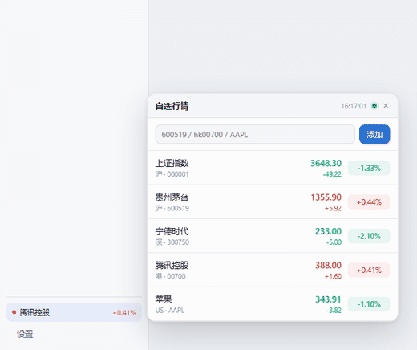

# dsh-stock-ticker

[](LICENSE)
[](https://www.npmjs.com/package/dsh-stock-ticker)
[](https://github.com/lengyeyu123/dsh-stock-ticker/actions/workflows/ci.yml)
[](https://github.com/anywhere-labs/dsh-desktop)

DSH Desktop / DeepSeek Harness 的自选股行情插件。侧栏常驻一条实时报价，点开是浮层面板：
自选列表 → 点任意标的 → 分时图 / 柱状图，支持 A 股、港股、美股。

> 仓库：<https://github.com/lengyeyu123/dsh-stock-ticker>

- 数据源：腾讯行情（`qt.gtimg.cn` + `web.ifzq.gtimg.cn`），免费、无需 API Key
- 双半区：宿主侧代理 + 浏览器侧 UI，宿主不可用时浏览器直连兜底
- 涨跌配色遵循 A 股习惯：**红涨绿跌**



免构建预览：直接打开 `preview/stock-panel-preview.html`（直连真实行情）。
若浏览器拦截跨域，用 `python -m http.server` 起个本地服务再访问；断网时加 `?mock=1` 看离线演示数据，
`?theme=dark` 切深色，`?bare=1` 隐藏说明文字便于截图，`#code=sh600519` 直接打开某个标的。

## 功能

| 能力 | 说明 |
| --- | --- |
| 实时报价 | 默认 5s 一轮，可选 3s / 5s / 10s / 30s / 60s；窗口不可见时自动停轮询 |
| 自选管理 | 输入 `600519` / `sh600519` / `600519.SH` / `700` / `AAPL` / `AAPL.OQ` 都能识别，自动归一化 |
| 分时图 | 价格折线 + 均价虚线 + 昨收零轴 + 右侧百分比轴 + 十字光标读数 |
| 柱状图 | 上方切「柱状」→ 每分钟价格相对昨收的涨跌柱；下方常驻成交量柱（按分钟涨跌上色） |
| 侧栏入口 | 挂在 `sidebar.footer.action` 槽位，轮播自选标的的涨跌幅 |
| 行情页 | 同时注册 `settings.section` 一级页面，作为大屏看板与槽位缺失时的兜底 |

## 目录结构

```
dsh-stock-ticker/
├── cordis.patch.yml          # 插件行清单，dsh plugin 靠它挂载
├── package.json              # dsh.bundle.patch + dsh.client 声明
├── tsdown.config.ts          # 双半区构建（host: ESM / client: __ModuleLoader__ 闭包工厂）
├── icon.svg
├── preview/
│   └── stock-panel-preview.html   # 免构建的界面预览（直连真实行情）
└── src/
    ├── index.ts              # host 半区入口：注册 /api/dsh-stock/*
    ├── core/
    │   ├── types.ts          # 跨半区契约
    │   └── symbol.ts         # 代码归一化
    ├── host/
    │   ├── tencent.ts        # 腾讯行情抓取、GBK 解码、单位折算、TTL 缓存
    │   └── routes.ts         # HTTP 路由
    └── client/
        ├── index.ts          # browser 半区入口：槽位注册 + 浮层挂载
        ├── store.ts          # 极简可观察 store + localStorage 持久化
        ├── api.ts            # 宿主代理优先、浏览器直连兜底
        ├── theme.ts          # 亮/暗主题探测与调色板
        ├── format.ts         # 数字/成交量/成交额格式化
        ├── locales.ts        # 文案字典
        ├── StockDock.tsx     # 轮询循环 + 浮层容器
        ├── StockTickerButton.tsx  # 侧栏入口按钮
        ├── StockPanel.tsx    # 列表 / 详情面板
        ├── StockPage.tsx     # 一级页面落位
        └── IntradayChart.tsx # 分时图 / 柱状图（纯 SVG 手绘）
```

## 安装

### 从 npm 安装（推荐）

```bash
dsh plugin --profile <profile-name> add dsh-stock-ticker
```

包地址：<https://www.npmjs.com/package/dsh-stock-ticker>

装完重启 DSH Desktop（或重新加载当前工作配置），侧栏底部会出现「自选行情」按钮。

### 从 GitHub 安装（跟最新代码）

```bash
dsh plugin --profile <profile-name> add github:lengyeyu123/dsh-stock-ticker
```

### 本地开发

```bash
git clone https://github.com/lengyeyu123/dsh-stock-ticker.git
cd dsh-stock-ticker
npm install
npm run build          # 产出 lib/index.js + lib/client.js + lib/types/

# 链接进当前 profile
dsh plugin --profile <profile-name> add "link:<绝对路径>/dsh-stock-ticker"
```

> `lib/` 和 `node_modules/` 不进版本库，所以 clone 下来必须先 `npm install && npm run build`。
> 用 `link:` 安装时也必须指向**已构建**的目录。

### 卸载

```bash
dsh plugin --profile <profile-name> remove dsh-stock-ticker
```

## 开发与发布

```bash
npm run typecheck   # tsc --noEmit
npm run build       # 产出 lib/index.js + lib/client.js + lib/types/
npm run clean       # 删掉 lib/
```

仓库自带两个 workflow：

| workflow | 触发 | 做什么 |
| --- | --- | --- |
| `ci.yml` | push / PR 到 `main` | Node 22 与 24 双版本跑类型检查 + 构建，并校验产物约定（`client.js` 必须是 `__ModuleLoader__` 闭包工厂、只能 `require` 冻结模块表里的依赖、类型声明要能对上 `exports`） |
| `release.yml` | 推送 `v*` tag | 校验 tag 与 `package.json` 版本一致，再 `npm publish --provenance` |

发布步骤：

1. 仓库 Settings → Secrets and variables → Actions 里加 `NPM_TOKEN`（npm 的 Automation token）
2. `npm version patch && git push --follow-tags`
3. workflow 自动发布带 provenance 的包

也可以在 Actions 页手动触发 Release，默认 `dry-run` 只打包不发布。

## HTTP 接口

宿主半区只做代理，不落盘、不鉴权、不保存用户数据（自选股在浏览器 `localStorage` 里）。

| 路由 | 说明 |
| --- | --- |
| `GET /api/dsh-stock/quotes?codes=sh600519,hk00700,usAAPL` | 批量实时快照，单次上限 40 个 |
| `GET /api/dsh-stock/minute?code=sh600519` | 单只标的当日分时序列 |

响应体：

```jsonc
// quotes
{ "ok": true, "quotes": [{ "code": "sh600519", "name": "贵州茅台", "price": 1355.9, "changePct": 0.44, ... }] }

// minute
{ "ok": true, "series": { "code": "sh600519", "prevClose": 1349.98, "points": [{ "time": "09:30", "price": 1343.88, "avg": 1343.88, "volume": 21000 }] } }
```

## 数据源与单位折算

两个端点都返回 `Access-Control-Allow-Origin: *`，所以浏览器侧也能直连；宿主代理的价值在于
GBK 解码、单位统一和 TTL 缓存（快照 2.5s / 分时 8s）。

| 市场 | 快照接口 | 分时接口 | 成交量单位 | 成交额单位 |
| --- | --- | --- | --- | --- |
| A 股 / 北交所 | `qt.gtimg.cn/q=` | `minute/query` | 手（×100 → 股） | 万元（×10000 → 元） |
| 港股 | 同上 | `minute/query` | 股 | 元 |
| 美股 | 同上 | `UsMinute/query` | 股 | 美元 |

美股分时在未开盘时只会返回一个点，此时面板会显示「暂无分时数据（可能未开盘或已休市）」。

## 构建产物约定

DSH 的 browser 半区不是普通 ESM，而是闭包工厂产物：

```js
window.__ModuleLoader__.load({ id: 'dsh-stock-ticker', factory: (require) => { ... } })
```

外部依赖通过 loader 注入的 `require` 从 shell 的冻结模块表解析，所以 `tsdown.config.ts` 里的
`PLATFORM_MODULES` 必须与 shell 的 `web-platform.ts` 完全一致：

```
react, react/jsx-runtime, react-dom, react-dom/client, @deepseek-ai/cordis,
zod, @tanstack/react-virtual, @deepseek-ai/dsh-client-store,
@deepseek-ai/dsh-client-ui-slots, @deepseek-ai/dsh-client-ui-primitives,
@deepseek-ai/dsh-client-ui-dockkit
```

表外依赖一律内联 —— 本插件只用 `react` 与 `react-dom/client`，没有第三方图表库（分时图是纯 SVG 手绘）。

## 已知限制

- 腾讯接口是公开免费接口，没有 SLA；高频轮询可能被限流，默认 5s 已经比较保守。
- 不支持分笔、五档盘口、K 线切换（这些要另接 `kline/mkline`，且该端点当前需要换 host）。
- 美股分时依赖 `UsMinute/query`，盘前盘后数据不完整。
- 侧栏槽位 `sidebar.footer.action` 在不同 shell 版本上可能不存在；不存在时插件仍可通过
  设置页的「自选行情」进入。

## 许可证

[MIT](LICENSE) © 2026 lengyeyu123

行情数据版权归腾讯及各交易所所有，本插件仅做个人行情展示用途。
